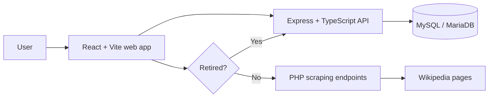

<div align="center">
  
  <h1>StarStats</h1>
  <p><strong>Tennis statistics, player insights, and cross-competition comparisons.</strong></p>
  <p>A full-stack platform built with React, Express, TypeScript, PHP, and MySQL.</p>
  <p>
    
    
    
    
    
    
    
  </p>
  <p>
    <a href="#features">Features</a> ·
    <a href="#architecture">Architecture</a> ·
    <a href="#installation--getting-started">Getting started</a> ·
    <a href="#environment-variables">Configuration</a>
  </p>
</div>

## Overview

StarStats brings player search, detailed athlete cards, and competition comparisons into one tennis statistics app. Its source-aware data flow serves retired athletes from MySQL/MariaDB and enriches active-player information with data scraped from Wikipedia.

## Features

- Search tennis players from the landing page.
- View player cards with personal details, country flags, sport icons, retirement status, and title counts.
- Choose the athlete data source based on retirement status: database records for retired players and Wikipedia scraping for active players.
- Compare selected players by titles or matches for a chosen competition.
- Display comparison results in a pie chart using Recharts.
- Serve structured player and competition data through an Express API.
- Enrich active-player cards and competition stats through PHP scraping endpoints.
- Load the database from a versioned SQL schema with demo data.

## Technology Stack

| Layer | Technologies |
| --- | --- |
| Frontend | React 18, Vite, NextUI, Tailwind CSS, React Router, Recharts, Axios |
| API | Node.js, Express 4, TypeScript, mysql2, express-session |
| Data enrichment | PHP, DOMDocument, XPath, Wikipedia |
| Database | MySQL or MariaDB |
| Quality checks | ESLint, TypeScript compiler, GitHub Actions |

## Architecture



The app reads each player's retirement status from the database through the Express API, then selects the source for athlete details. Retired players are served from the database; active players are looked up by the PHP scraping service, which extracts selected fields from Wikipedia and returns JSON to the frontend.

## Installation / Getting Started

### Prerequisites

- Node.js 20 or newer
- npm
- MySQL or MariaDB
- PHP 8 or newer with DOM support enabled

### 1. Clone the repository

```bash
git clone https://github.com/theblondcoder/StarStats.git
cd StarStats
```

### 2. Create the database

Import the schema and demo data:

```bash
mysql -u root -p < database/schema.sql
```

The schema creates and uses a database named `star_stats`.

### 3. Configure the API

```bash
cd StarStats-API
cp .env.example .env
npm ci
npm run build
npm run dev
```

The API runs on `http://localhost:5900` by default.

### 4. Configure the web app

```bash
cd ../web-app
cp .env.example .env
npm ci
npm run dev
```

The web app runs on `http://localhost:5173` by default.

### 5. Serve the PHP scraping endpoints

Expose `ficheros Scraping/StarStats-SCRAPING` through a local PHP server or an Apache/PHP setup so the frontend can reach:

```text
http://localhost/StarStats-SCRAPING
```

Update `REACT_APP_SCRAPING_URL` in `web-app/.env` if you serve it from a different URL.

## Environment Variables

### `StarStats-API/.env`

| Variable | Description | Default |
| --- | --- | --- |
| `PORT` | API server port | `5900` |
| `CLIENT_ORIGIN` | Allowed frontend origin for CORS | `http://localhost:5173` |
| `DB_HOST` | Database host | `localhost` |
| `DB_PORT` | Database port | `3306` |
| `DB_USER` | Database user | `root` |
| `DB_PASSWORD` | Database password | empty |
| `DB_NAME` | Database name | `star_stats` |
| `DB_CONNECTION_LIMIT` | MySQL connection pool size | `10` |
| `SESSION_SECRET` | Express session secret | required for non-local use |

### `web-app/.env`

| Variable | Description | Default |
| --- | --- | --- |
| `REACT_APP_API_URL` | Base URL for the Express API routes | `http://localhost:5900/API-StarStats` |
| `REACT_APP_SCRAPING_URL` | Base URL for the PHP scraping endpoints | `http://localhost/StarStats-SCRAPING` |

## Project Structure

```text
StarStats/
|-- StarStats-API/                  # Express + TypeScript API
|-- web-app/                        # React + Vite frontend
|-- ficheros Scraping/
|   `-- StarStats-SCRAPING/         # PHP scraping endpoints
|-- database/
|   `-- schema.sql                  # MySQL/MariaDB schema and demo data
`-- .github/                        # CI and contribution templates
```

## Technical Highlights

- Environment-based API, CORS, session, and database configuration.
- Strict TypeScript build for the backend.
- Frontend linting and production build checks through npm scripts.
- SQL schema with relational tennis data and demo user records.
- Clear separation between frontend UI, backend API, scraping service, and database schema.
- GitHub Actions workflow for API and frontend validation.

## Future Improvements

- Add automated API and UI tests.
- Replace the PHP scraping endpoints with a typed backend integration service.
- Add authentication flows for the favorite-player dashboard.
- Improve code splitting in the frontend bundle.
- Add a hosted demo once deployment is configured.

## Author

Ivan Baltanas Ortiz
